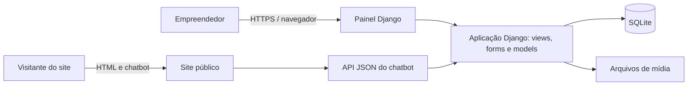
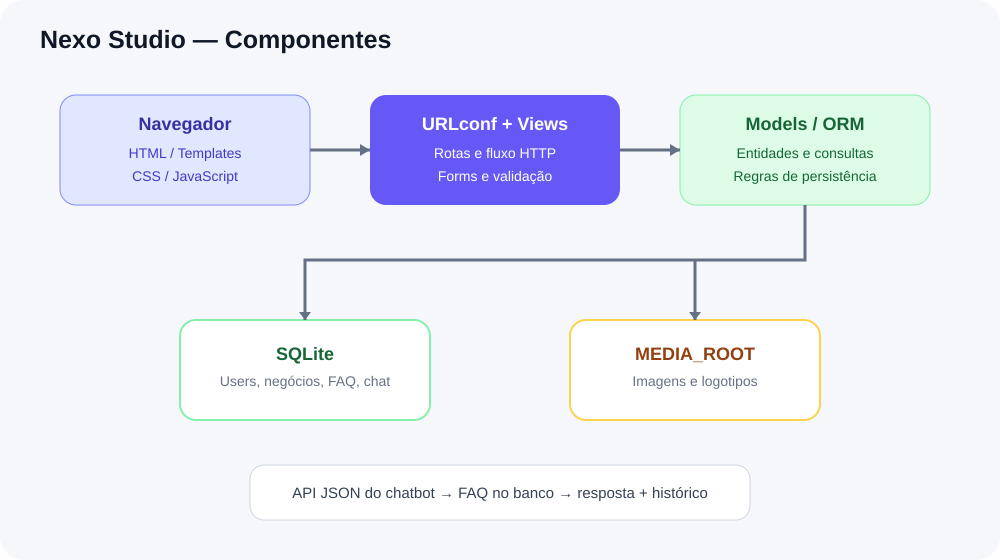
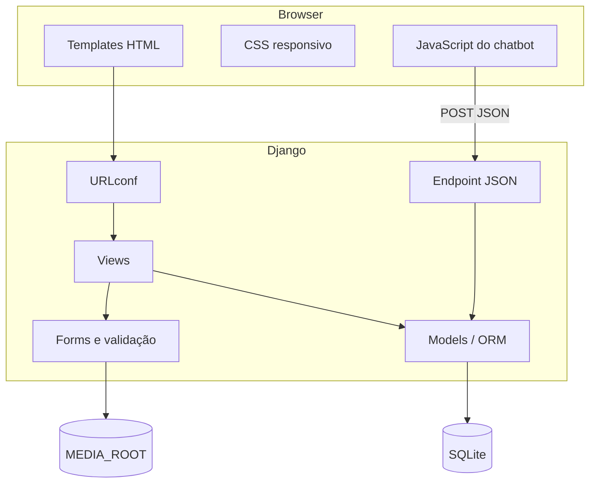
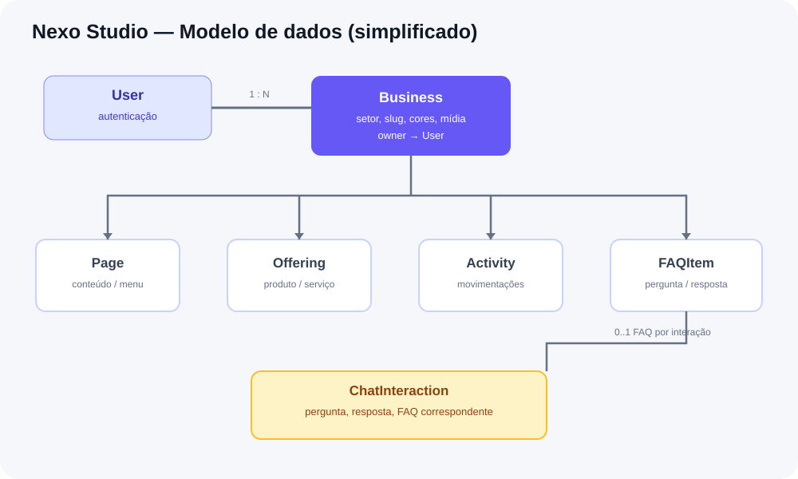
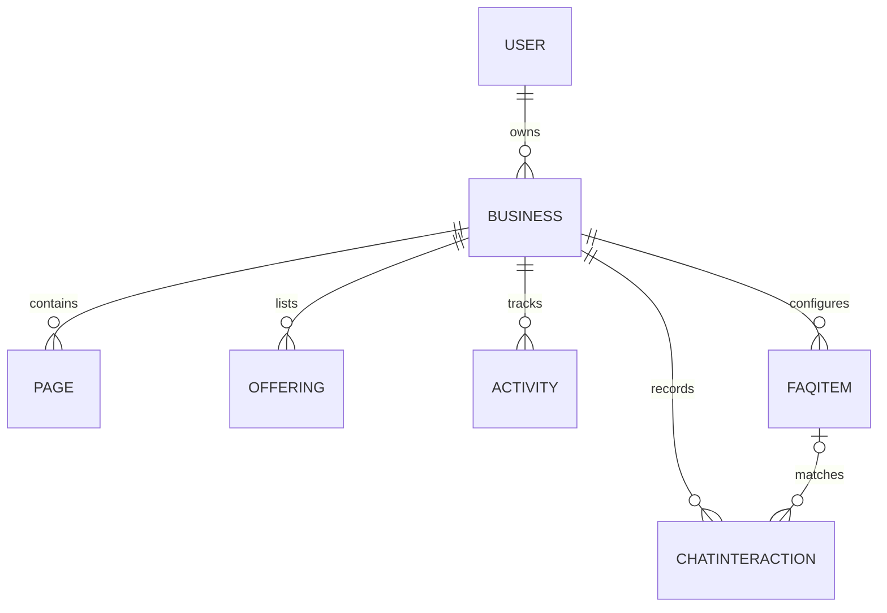
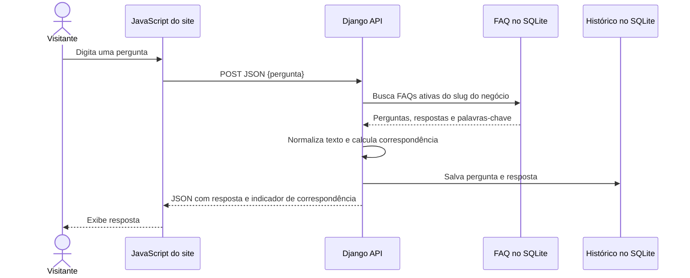
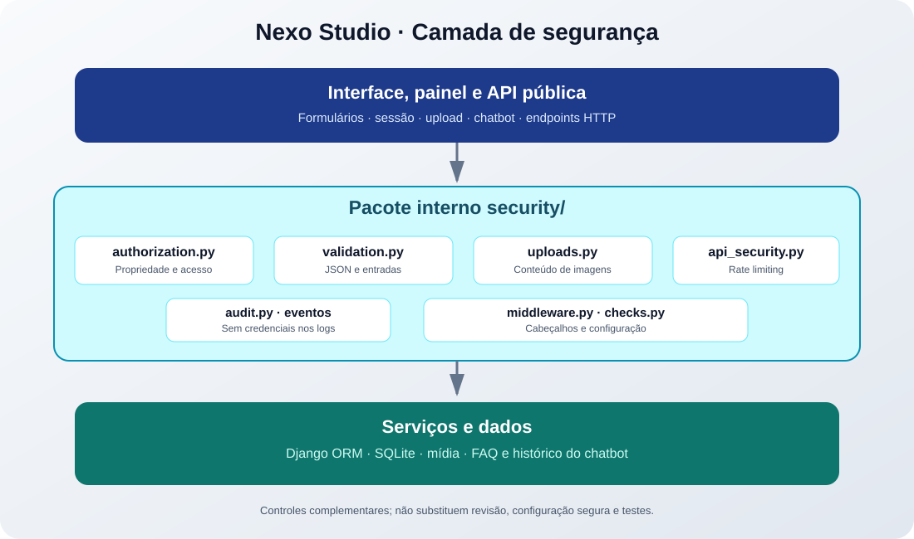

# Arquitetura do Nexo Studio

## 1. Diagrama de contexto

O empreendedor administra conteúdo e identidade visual no painel. O visitante acessa o site publicado e pode interagir com o chatbot. As duas experiências usam o mesmo backend Django, mas fluxos de URL e permissões distintos.

## 2. Componentes e responsabilidades

| Componente | Tecnologia | Responsabilidade | Local |
|---|---|---|---|
| Interface | HTML5 / Django Templates | Estrutura de páginas, menus, formulários e site público | `templates/studio/` |
| Estilo | CSS | Layout responsivo, cores e componentes visuais | `static/css/app.css` |
| Interatividade | JavaScript | Menu móvel e envio assíncrono da pergunta do chatbot | `static/js/app.js` e script do site público |
| Roteamento | Django URLconf | Relaciona URL a uma view | `config/urls.py`, `studio/urls.py` |
| Regras HTTP | Django views | Autenticação, validação, consultas e respostas | `studio/views.py` |
| Validação de formulários | Django Forms | Valida campos e uploads antes de salvar | `studio/forms.py` |
| Domínio | Django ORM / Models | Define negócios, páginas, catálogo, movimentos, FAQs e interações | `studio/models.py` |
| Persistência | SQLite | Guarda dados estruturados em arquivo local | `db.sqlite3` (criado ao migrar) |
| Mídia | Sistema de arquivos em desenvolvimento | Guarda logotipos e imagens enviadas | `media/` |
| API | HTTP + JSON | Recebe pergunta e devolve resposta estruturada | `/api/chat/<slug>/` |
| Documentação | Markdown / SVG / Mermaid | Ensina arquitetura, fluxos e manutenção | `docs/` |

## 3. Diagrama de componentes

## 4. Modelo de dados simplificado

| Entidade | Chave/atributos principais | Observações |
|---|---|---|
| Business | `owner`, `slug`, `sector`, cores, imagens | Perfil do negócio e identidade visual |
| Page | `business`, `slug`, `menu_label`, `sort_order` | `slug` é único por negócio |
| Offering | `business`, `kind`, `name`, `price`, `active` | Produto ou serviço |
| Activity | `business`, `kind`, `status`, `amount`, `activity_date` | Base dos relatórios operacionais |
| FAQItem | `business`, `question`, `answer`, `keywords`, `active` | Conteúdo gerenciado pelo cliente |
| ChatInteraction | `business`, `question`, `answer`, `matched_faq`, `created_at` | Registro para auditoria e melhoria da FAQ |

## 5. Sequência do chatbot

## 6. Fluxo de publicação do site

1. O proprietário configura o negócio e escolhe a identidade visual.
2. Cria páginas, produtos/serviços e perguntas/respostas.
3. Marca o negócio como publicado.
4. A rota `/s/<slug>/` busca apenas negócios publicados.
5. O template monta menu, hero, catálogo, páginas, contato e widget do chatbot.
6. O chatbot consulta `/api/chat/<slug>/` e usa apenas a base de conhecimento daquele negócio.

## 7. Decisões técnicas e trade-offs

| Decisão | Vantagem no ensino | Limitação / evolução |
|---|---|---|
| Django | ORM, autenticação, templates e forms integrados | Aprender convenções e ciclo de requisição |
| SQLite | Sem servidor de banco adicional, ótimo para Codespaces e aula | Escritas concorrentes e escala menores que bancos de produção |
| Templates Django | Integração direta com views e dados | Frontend não é SPA; pode evoluir para frontend separado |
| FAQ por matching | Previsível, explicável, sem custo de API externa | Não entende intenção complexa; pode evoluir para NLP/LLM com salvaguardas |
| Upload local | Fácil de demonstrar | Em produção, usar armazenamento persistente e validação de arquivo robusta |
| CSV para FAQ | Fácil de criar e editar em planilha | Validar encoding, separador, colunas e tamanho de arquivo |

## 8. Camada de segurança

A camada complementar de segurança fica no pacote `security/` e centraliza validação de JSON, rate limiting do chatbot, validação real de uploads, auditoria, cabeçalhos e checks de configuração. O diagrama detalhado e os limites conhecidos estão em [`SEGURANCA.md`](SEGURANCA.md).

## 9. Segurança e implantação

Este projeto é para ensino e execução em ambiente de desenvolvimento. Antes de qualquer implantação comercial:

- `DEBUG=False`, `SECRET_KEY` em variável de ambiente e `ALLOWED_HOSTS` restrito.
- HTTPS, cookies seguros, política de CORS/CSRF revisada e rate limiting para endpoints públicos.
- Validar conteúdo real dos arquivos enviados, tamanho e dimensões; armazenar mídia fora do código.
- Backups e política de retenção para banco e histórico do chat.
- Revisar autorização em todas as operações e garantir que usuário só acesse o próprio negócio.
- Migrar para PostgreSQL e armazenamento de objetos quando necessário.
- Não registrar dados sensíveis; informar ao visitante que a conversa pode ser armazenada.

## 10. Como atualizar o diagrama quando a arquitetura mudar

Edite o Mermaid correspondente neste documento e atualize o SVG em `docs/diagramas/`. Os SVGs são imagens autônomas para visualização em Markdown ou em material didático. O diagrama e a implementação devem permanecer coerentes; não documente um serviço externo que não esteja realmente configurado.
