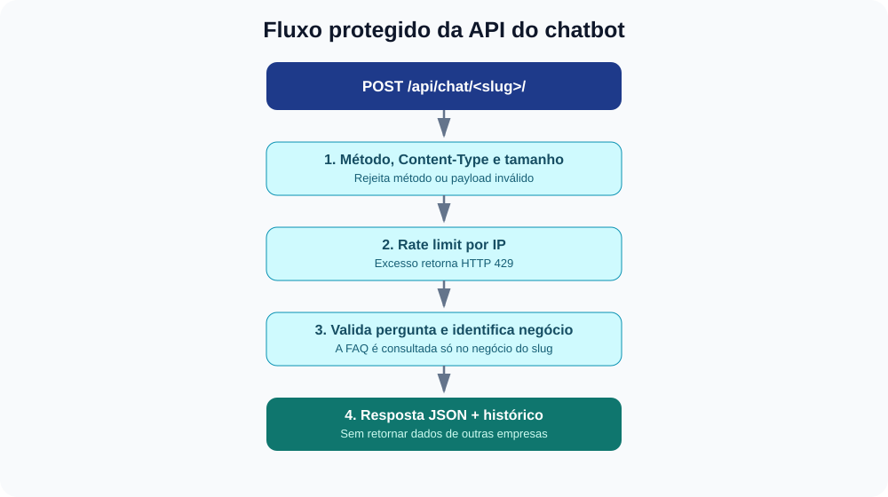

# Camada de segurança do Nexo Studio

> **Objetivo didático:** apresentar como o Nexo Studio organiza controles de segurança reutilizáveis. Este documento descreve o que está implementado nesta versão, como testar e quais controles adicionais são necessários antes de uma implantação real.


## 1. Por que uma camada de segurança?

Em vez de repetir as mesmas verificações em cada view, o projeto reúne funções complementares no pacote `security/`. Isso melhora a consistência, facilita os testes e deixa explícito onde cada controle está implementado. O pacote **não substitui** autenticação, ORM, escape de templates, CSRF e demais proteções nativas do Django.

## 2. Mapa dos módulos

| Arquivo | Responsabilidade | Exemplo no projeto |
|---|---|---|
| `security/authorization.py` | Helpers para garantir que o usuário só encontre negócios que possui e que objetos estejam dentro do negócio autorizado | `get_business_or_404()` e `get_owned_object_or_404()` |
| `security/validation.py` | Validar tamanho e estrutura do JSON e o campo de pergunta do chatbot | Limite de 8 KiB por corpo JSON e 500 caracteres por pergunta |
| `security/api_security.py` | Limitar chamadas repetidas a endpoints públicos | Até 30 chamadas por IP por janela de 60 segundos, por slug do chatbot |
| `security/uploads.py` | Verificar tamanho, tipo declarado e conteúdo real de imagens | Uploads de logo e imagem de destaque |
| `security/audit.py` | Registrar eventos de segurança sem gravar senhas, tokens ou corpo completo da requisição | Excesso de chamadas e payload acima do limite |
| `security/middleware.py` | Adicionar cabeçalhos HTTP defensivos | `X-Content-Type-Options`, `Referrer-Policy` e `Permissions-Policy` |
| `security/checks.py` | Alertar sobre configurações potencialmente inseguras | `DEBUG`, `SECRET_KEY` e `ALLOWED_HOSTS` |

## 3. Como a API do chatbot é protegida



O endpoint público `/api/chat/<slug>/` precisa aceitar visitantes sem login para que o chatbot funcione no site público. Por esse motivo, ele não exige autenticação. Como contrapartida, aplica validações e limites específicos:

1. Aceita somente `POST` e exige `Content-Type: application/json`.
2. Rejeita corpos acima de 8 KiB e JSON que não seja um objeto com campos nomeados.
3. Exige uma pergunta textual com 2 a 500 caracteres.
4. Aplica limitação básica por IP: 30 chamadas por janela de 60 segundos, por slug.
5. Busca apenas negócios publicados e consulta somente a FAQ daquele negócio.
6. Registra a interação no histórico do negócio correspondente.

O endpoint continua com `csrf_exempt` porque é uma API pública, usada por visitantes anônimos e sem ações autenticadas. Isso não significa que CSRF deva ser desativado no restante da aplicação. Não envie segredos, dados pessoais desnecessários ou informações sensíveis no chatbot.

### Exemplo de chamada

```bash
curl -X POST "https://SEU_HOST/api/chat/slug-do-negocio/" \
  -H "Content-Type: application/json" \
  -d '{"pergunta":"Qual o horário de atendimento?"}'
```

**O que observar:** uma requisição válida retorna JSON com `resposta`, `encontrada` e `negocio`. Se o limite for excedido, a API responde HTTP `429`. Payload inválido retorna `400`, tipo de conteúdo inadequado retorna `415`, e método não permitido retorna `405`.

## 4. Upload seguro de imagens

O formulário aceita imagens JPEG, PNG, WEBP ou GIF. O limite é de 5 MB para imagem de destaque e 2 MB para logo. A validação examina o formato real da imagem com Pillow, além do tipo MIME declarado. SVG foi excluído dos uploads, pois pode carregar conteúdo ativo. O nome do arquivo ou o `Content-Type` isoladamente não são provas suficientes de que um arquivo é seguro.

Ainda assim, a validação de formato não elimina todos os riscos. Em produção, mantenha as bibliotecas atualizadas, considere reprocessar imagens, defina limites de dimensões e armazene arquivos em serviço de mídia apropriado, sem permissão de execução.

## 5. Configuração por variáveis de ambiente

O projeto usa estas variáveis:

| Variável | Finalidade | Exemplo de desenvolvimento |
|---|---|---|
| `NEXO_SECRET_KEY` | Segredo criptográfico do Django | Gere uma chave aleatória; não a publique no repositório |
| `NEXO_DEBUG` | Liga/desliga modo de depuração | `1` em desenvolvimento; `0` em ambiente publicado |
| `NEXO_ALLOWED_HOSTS` | Hosts permitidos, separados por vírgula | `localhost,127.0.0.1,seu-host.example` |
| `NEXO_SECURE_SSL_REDIRECT` | Redireciona HTTP para HTTPS quando `DEBUG=False` | `1` se HTTPS estiver configurado corretamente |
| `NEXO_HSTS_SECONDS` | Duração do cabeçalho HSTS | Comece com `0`; habilite após validar HTTPS em todos os hosts |

**Não copie uma chave secreta de exemplo para produção.** Gere uma chave aleatória e armazene-a no gerenciador de segredos da plataforma. Não habilite redirecionamento HTTPS em um ambiente que não esteja servindo HTTPS.

Exemplo de configuração em terminal Linux/macOS para uma sessão de desenvolvimento:

```bash
export NEXO_SECRET_KEY="substitua-por-uma-chave-aleatoria-longa"
export NEXO_DEBUG="1"
export NEXO_ALLOWED_HOSTS="localhost,127.0.0.1"
```

O comando `export` define variáveis apenas para o terminal/sessão atual e processos iniciados por ele. Em Codespaces, use os recursos de secrets/variáveis do ambiente quando necessário e nunca inclua valores secretos no Git.

## 6. Como executar as verificações

```bash
python manage.py check
python manage.py check --deploy
python manage.py test studio
```

- `check` verifica problemas gerais do projeto e inclui os checks próprios do Nexo Studio.
- `check --deploy` apresenta recomendações de implantação segura do Django. Em desenvolvimento, alguns avisos são esperados; analise cada um, não os ignore automaticamente.
- `test studio` executa os testes automatizados do app, incluindo isolamento entre empresas, validações da API e cabeçalhos de segurança.

Os testes são evidência de comportamento para cenários cobertos, não uma certificação de segurança. Inclua testes para cada novo endpoint e regra de autorização criada.

## 7. Limitações conhecidas e evolução necessária

Esta camada é um ponto de partida educacional, não uma certificação ou garantia de segurança. Antes de produção:

- Substitua o cache local pelo Redis ou outro cache compartilhado e configure rate limiting adicional em proxy/WAF. O limite atual é simples e não substitui proteção distribuída contra abuso.
- Configure HTTPS, domínio, `DEBUG=False`, `SECRET_KEY` forte, hosts permitidos, cookies seguros e revisão dos cabeçalhos de implantação.
- Adicione uma política CSP testada. O projeto ainda possui scripts/estilos inline; impor CSP estrita sem refatoração pode quebrar a interface.
- Considere autenticação, quotas e controles específicos para integrações externas; a API atual é pública por design.
- Defina política de retenção, aviso de privacidade e exclusão do histórico do chatbot.
- Revise permissões, dependências, backups, logs, upload e recuperação de dados.
- Faça revisão de segurança independente antes de processar dados reais de clientes.

## 8. Referências de estudo

- [OWASP Top 10](https://owasp.org/www-project-top-ten/) — categorias de riscos comuns em aplicações web.
- [OWASP Application Security Verification Standard (ASVS)](https://owasp.org/www-project-application-security-verification-standard/) — requisitos verificáveis para orientar testes.
- [Documentação de segurança do Django](https://docs.djangoproject.com/en/stable/topics/security/) — proteções nativas e recomendações de implantação.

## 9. Exercícios para os alunos

1. Altere temporariamente o limite do chatbot para 3 chamadas e comprove quando ocorre HTTP `429`; depois restaure o limite padrão.
2. Envie um JSON que seja uma lista, em vez de objeto, e explique por que a API retorna `400`.
3. Tente enviar um arquivo que tenha extensão `.png`, mas não seja uma imagem válida; explique por que validar apenas a extensão seria insuficiente.
4. Crie um teste que tente acessar uma página pertencente a outro usuário.
5. Execute `check --deploy`, registre os avisos e classifique cada um como configuração, infraestrutura ou código.

---

**Escopo:** controles implementados no protótipo educacional Nexo Studio. A adequação a um ambiente real depende da configuração do hosting, revisão do código e testes adicionais.
